<p align="center">
  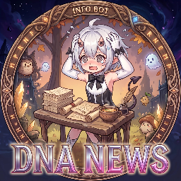
</p>

<h1 align="center">Duet Night Abyss Assistent</h1>

<p align="center">
  Companion app for <b>Duet Night Abyss</b> on Windows – track Demon Wedges, builds, Geniemons and Covert Commissions,<br>
  with hotkeys that read the game screen for you. Everything runs locally on your PC.
</p>

<p align="center">
  <a href="../../releases/latest"></a>
  <a href="../../releases"></a>
  
  
</p>

<p align="center">
  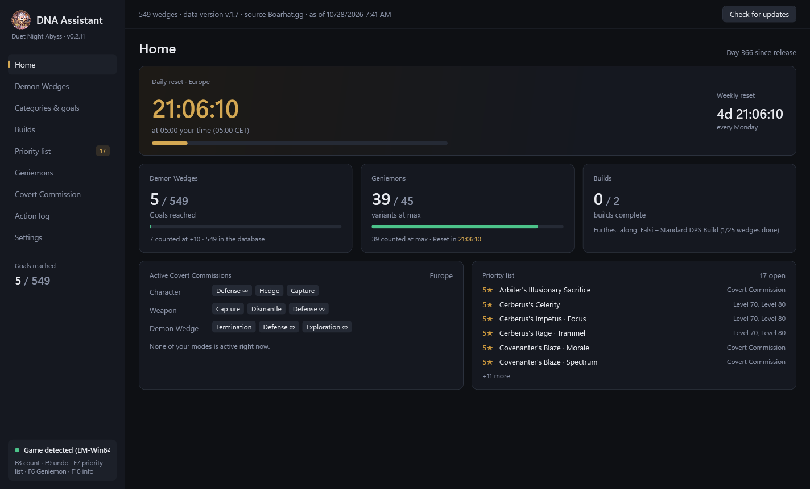
</p>

---

## Download

👉 **[Download the latest version](../../releases/latest)** – under “Assets”, get `DnaAssistant.exe`.

- No installation needed – just run it.
- The app asks for **administrator rights** on startup. The game runs with administrator rights; without them, hotkeys and screen capture can't reach it.
- New versions are announced in the app on startup and installed with one click.
- Windows SmartScreen may warn on first launch (“Unknown publisher”) – click **More info › Run anyway**.

## Hotkeys in game

| Key | What it does |
|:---:|---|
| **F8** | Counts the selected Demon Wedge when it's at max level (gold +10, others +5). Rarity is read from the card color. |
| **F10** | Shows info for the selected Demon Wedge: how many you have, your goal and whether you still need it – counts nothing. |
| **F6** | Geniemon view: counts the variant at max level (Lv. 60/60, three stars). Catch screen: tells you whether you still need it. |
| **F7** | Shows or hides your priority list over the game. |
| **F9** | Undoes the last hotkey action. |

All keys can be changed in the settings.

## Features

### 🗡️ Demon Wedges

All wedges from [boarhat.gg](https://boarhat.gg/games/duet-night-abyss/) with search and filters (category, element, rarity, polarity, source). Count your +10 copies, set a goal per wedge, and see main attributes, effects and where to get each one.

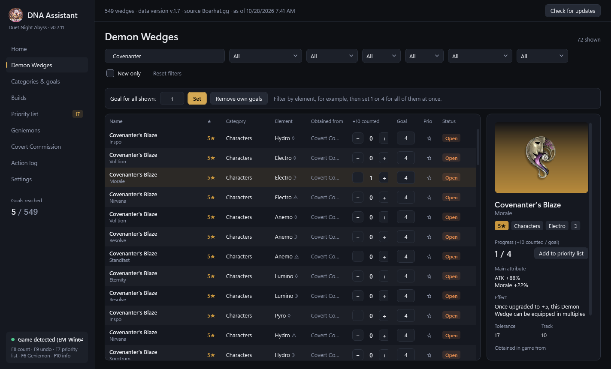

### 🎯 Categories & goals

Set how many copies you want per category or per wedge (for example 1 or 4), sort by done/open and jump straight to what's missing.

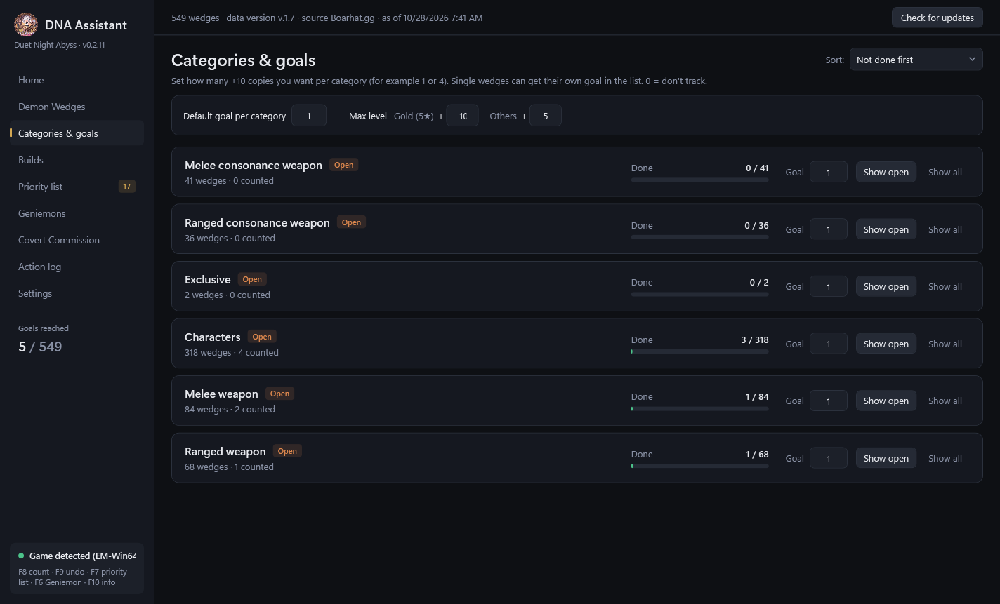

### 🧩 Builds

Import builds from a boarhat link or code, from boarhat presets or from a **screenshot of your wedge set** – the wedges are recognized and filled in. Type to search when picking the character, weapons and wedges. See progress like “3/10 wedges done”, send everything missing to the priority list in one click, and share builds as a link.

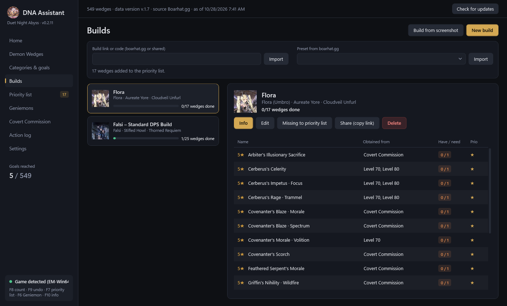

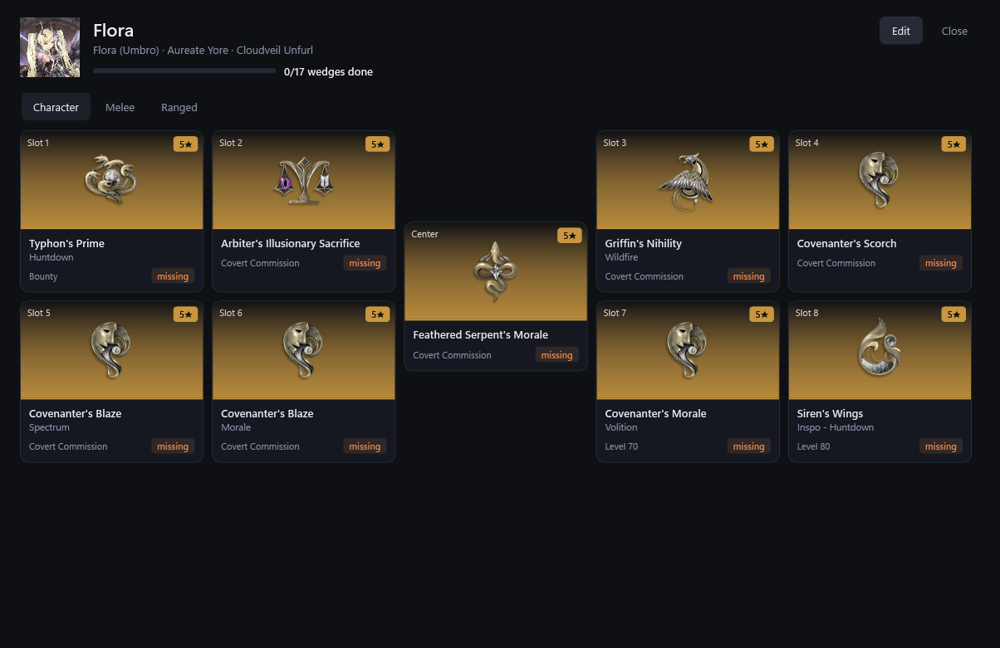

### ⭐ Priority list

The wedges you need next, including where to get them – press **F7** to show them over the game.

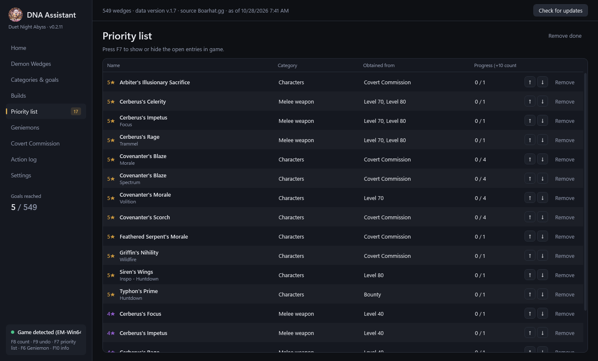

### 🐾 Geniemons

Your collection per variant (Miraculous, Ardent, Shiny) with a wanted amount per variant. Battle pass Geniemons are tracked without a limit, inactive ones are hidden.

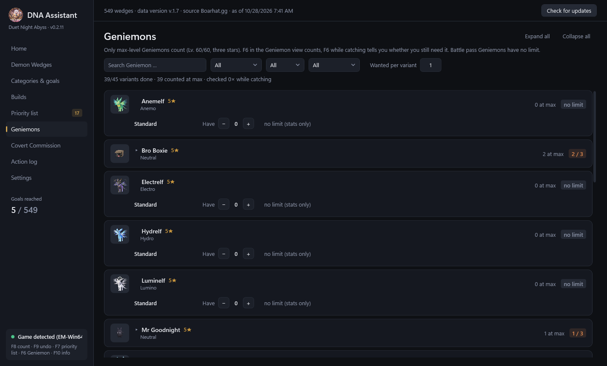

### 📡 Covert Commission

The current modes of all regions, refreshed every few minutes. Get a notification (with sound, if you like) when one of your modes shows up in your region, and share your selection as a code.

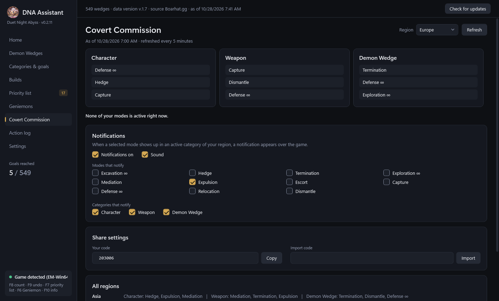

### 📝 Action log

Every change is recorded and can be undone one by one.

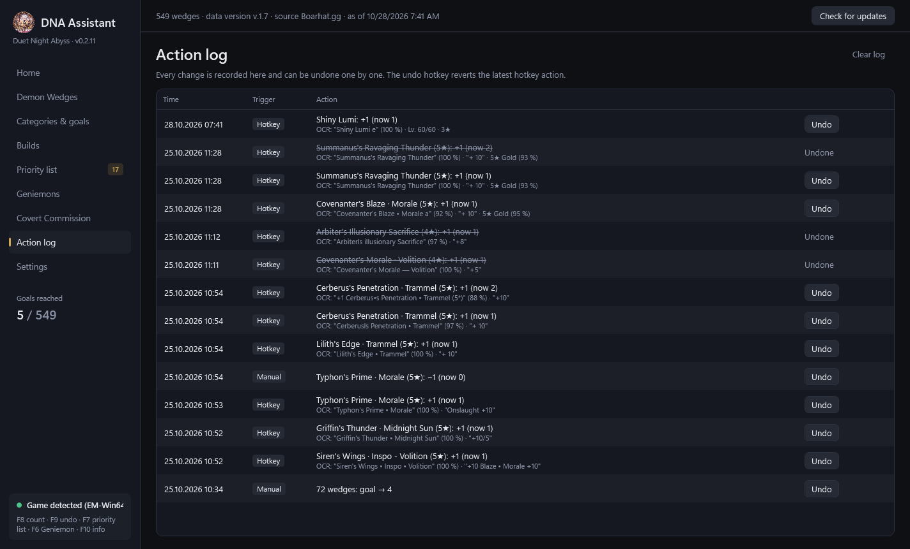

### ⚙️ Settings

Language, hotkeys, recognition areas, game detection, optional autostart via Steam or the launcher, and a button to delete all local data.

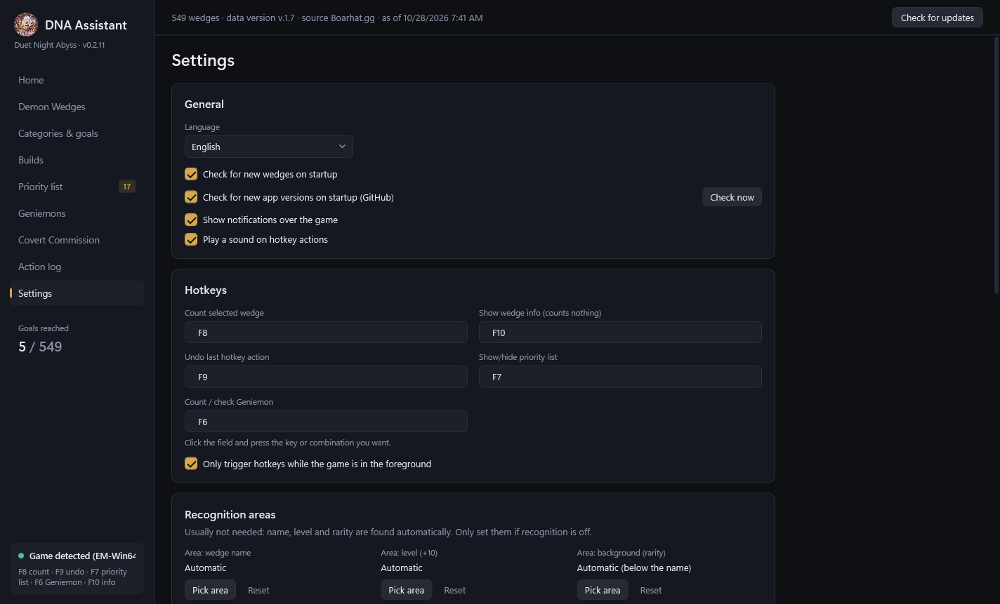

## Tips for good recognition

- Play in **windowed or borderless mode** – in exclusive fullscreen the capture can be black.
- Ideally install the English Windows text recognition – in an **administrator PowerShell**:
  ```
  Add-WindowsCapability -Online -Name "Language.OCR~~~en-US~0.0.1.0"
  ```

## Autostart (optional)

In the settings under **Autostart**:

- **Steam:** paste the shown launch option in Steam at Duet Night Abyss under *Properties › Launch options*.
- **Launcher:** create the desktop shortcut “DNA Assistant + Launcher” and/or start with Windows.

## Planned

- [ ] **Character tracking** – track which characters you own and level up
- [ ] **Weapon tracking** – track which weapons you own and level up

## Languages

Deutsch, English, Français, Español, Italiano, Português, Polski, Türkçe, Русский, Українська, 日本語, 한국어, 简体中文

## Data & privacy

All data (progress, builds, settings) stays on your PC in `%LocalAppData%\DnaAssistant`. The only things fetched online are public game data from [boarhat.gg](https://boarhat.gg/games/duet-night-abyss/), the Covert Commissions from a web API and new app versions here on GitHub. Text recognition uses the built-in Windows OCR – nothing is uploaded.

## Problems or ideas?

Feel free to report them via [Issues](../../issues) – for recognition problems, please attach a screenshot of the affected view.

---

<sub>Unofficial fan project, not affiliated with the developers or publishers of Duet Night Abyss.</sub>
